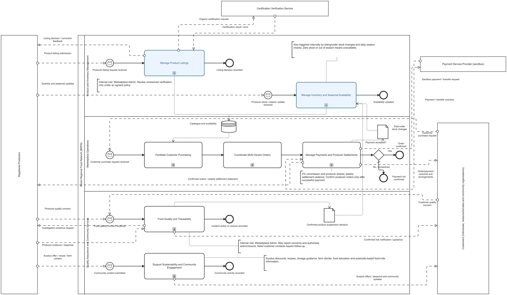

# Ayo's whole-enterprise strategic BPMN

Open [BRFN-Ayo-Strategic-BPMN.bpmn](BRFN-Ayo-Strategic-BPMN.bpmn) in Camunda Modeler. This is a separate personal modelling draft based on repository main **9aeeddc**, updated on 3 November 2026. It supports your contribution to shared [strategic BPMN issue #14](https://github.com/emami11/bristol-regional-food-network/issues/14).

## Diagram picture and source code

Open the [full-size PNG](BRFN-Ayo-Strategic-BPMN.png) or [vector SVG](BRFN-Ayo-Strategic-BPMN.svg) to inspect the overview. The `.bpmn` file contains the editable BPMN XML and diagram layout. The [Python generator](../../../tools/build_ayo_bpmn.py) creates that source and its geometry map; see [generation instructions](../../../tools/README.md).

## What it shows

The model retains the group's three business areas and seven major subprocesses:

| Lane | Subprocesses |
|---|---|
| Product and Inventory Management | Manage Product Listings; Manage Inventory and Seasonal Availability. |
| Marketplace Operations | Facilitate Customer Purchasing; Coordinate Multi-Vendor Orders; Manage Payments and Producer Settlements. |
| Quality Assurance and Community Services | Food Quality and Traceability; Support Sustainability and Community Engagement. |

There are five pools: BRFN, Registered Producers, Customers, Certification Verification Service and Payment Service Provider. The Customers pool explicitly covers individuals, restaurants/cafes and community organisations. Marketplace administrators are internal to BRFN and are identified through responsibility annotations.

The two blue subprocesses are the selected F1/F2 focus areas. The remaining business processes provide whole-enterprise context.

## Improvements to explain

- Listing and later stock updates have independent starts. A restock does not require a new product listing.
- Producer stock/season updates are shown as a message exchange.
- Listing and inventory update a shared catalogue; purchasing uses its current information.
- Successful paid orders produce stock-change records for Inventory Management.
- Confirmed quality concerns can produce a product-suspension decision used by Inventory Management.
- Producer evidence, customer quality notifications and failed-contact follow-up are represented or described.
- Payment communication covers provider outcomes, confirmed producer orders and settlement statements. Weekly settlement is distinguished from per-order payment.
- A high-level Payment accepted? XOR gateway distinguishes confirmed orders from No/unresolved outcomes. The Yes branch tests `paymentConfirmed`; the other branch is explicitly the default.
- Community content and surplus updates are communicated between producers, BRFN and customers.
- Wider responsibilities include the case study's 5% commission, 48-hour producer preparation lead time, food miles and educational content.

Solid arrows are sequence flows, dashed arrows are messages between pools, and dotted arrows show data associations or annotations. Data hand-offs do not by themselves trigger an executable workflow; the accompanying annotations identify the daily/internal triggers that must be implemented later.

## Strategic level

The file sets **isExecutable=false**. It is a whole-enterprise analysis diagram, not a deployed marketplace or the two completed operational processes required for Task 1. Detailed gateways, retry behaviour, approval forms, decision tables and error handling belong in the agreed operational F1/F2 models; the single overview gateway communicates a major business outcome.

Each collapsed subprocess has a separate high-level interior view for learning and explanation. These interiors name responsibilities; their simple sequence does not define every business exception or execution path. In particular, the payment subprocess does not imply that every purchase immediately triggers a weekly settlement, and a reported quality concern does not automatically establish a safety risk.

The extra interaction and data associations are proposed clarifications based on the repository and case study, not a claim of tutor approval. They leave the shared group BPMN unchanged.

## Sources and traceability

- Repository main `9aeeddc355d42e18477f753973677f85c8dadbbe` and issue #14.
- [Business analysis](../../../docs/business-analysis/README.md), [stakeholder analysis](../../../docs/stakeholder-analysis/README.md) and [actor analysis](../../../docs/actor-analysis.md).
- [Proposed functionalities](../../../docs/requirements/PROPOSED-FUNCTIONALITIES.md) and [requirements](../../../docs/requirements/README.md).
- Task 1 - Use Cases, pages 1-3, and Case Study - v2, pages 1-2, supplied in this chat.
- [Camunda BPMN symbol reference](https://camunda.com/bpmn/reference/).
- [Revised SR models](../../../models/istar/ayo/README.md).

Run `python tools/build_ayo_bpmn.py` to reproduce the editable XML and geometry map. Rebuilding replaces generated files, so preserve direct Modeler edits first.
