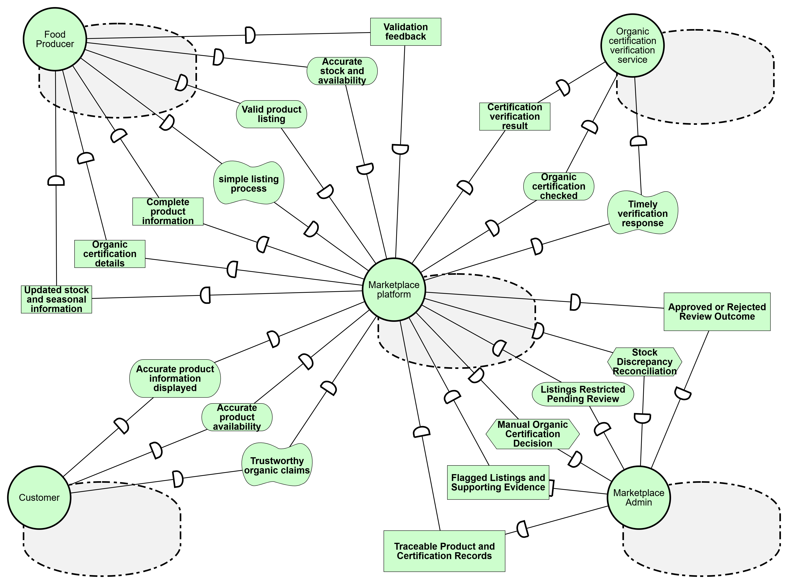

# Bristol Regional Food Network (BRFN)

## i* Strategic Dependency (SD) Model

**Use Case 1: Producer Product Listing and Inventory Management**

## Strategic Dependency Diagram

## 1. Introduction

The Strategic Dependency (SD) model explains how the different actors within the Bristol Regional Food Network (BRFN) depend on one another to achieve their objectives.

The model focuses on product listing and validation, inventory and seasonality management, and organic certification verification. It identifies the goals, tasks, resources, and qualities that actors depend on other actors to provide.

## 2. Actors Identified

The SD model contains five main actors:

- **Food Producer** Submits product information, provides organic certification details where applicable, and updates stock quantities and seasonal availability.
- **Marketplace Platform** Validates product information, manages product listings, supports organic certification checks, and maintains product availability.
- **Customer** Views product information and availability and expects reliable information about products.
- **Marketplace Admin** Supports compliance by carrying out manual verification reviews when required.
- **Organic Certification Verification Service** Checks organic certification information and returns verification results.

## 3. Strategic Dependencies

The model displays the following dependencies between the actors.

| Depender | Dependee | Dependency | Type |
|---|---|---|---|
| Food Producer | Marketplace Platform | Valid product listing | Goal |
| Food Producer | Marketplace Platform | Accurate stock and availability | Goal |
| Food Producer | Marketplace Platform | Simple listing process | Softgoal |
| Food Producer | Marketplace Platform | Validation feedback | Resource |
| Marketplace Platform | Food Producer | Complete product information | Resource |
| Marketplace Platform | Food Producer | Organic certification details | Resource |
| Marketplace Platform | Food Producer | Updated stock and seasonal information | Resource |
| Customer | Marketplace Platform | Accurate product information displayed | Goal |
| Customer | Marketplace Platform | Accurate product availability | Goal |
| Customer | Marketplace Platform | Trustworthy organic claims | Softgoal |
| Marketplace Platform | Organic Certification Verification Service | Organic certification checked | Goal |
| Marketplace Platform | Organic Certification Verification Service | Certification verification result | Resource |
| Marketplace Platform | Organic Certification Verification Service | Timely verification response | Softgoal |
| Marketplace Admin | Marketplace Platform | Compliant products published | Goal |
| Marketplace Platform | Marketplace Admin | Manual verification review | Task |

## 4. Types of Dependencies

- **Goal:** An outcome that the depender wants the dependee to achieve.
- **Task:** An activity that the depender relies on the dependee to perform.
- **Resource:** Information or data that the dependee is expected to provide.
- **Softgoal:** A desired quality or condition, such as a simple listing process or a timely verification response.

## 5. Conclusion

The SD model illustrates the relationships between the Food Producer, Marketplace Platform, Customer, Marketplace Admin, and Organic Certification Verification Service.

Successful product listing and inventory management depend on accurate information from producers, reliable validation and availability management by the platform, appropriate certification verification, and administrative support where necessary.

The SD model provides a foundation for developing the i* Strategic Rationale (SR) model and demonstrating traceability to the strategic and operational BPMN models.
