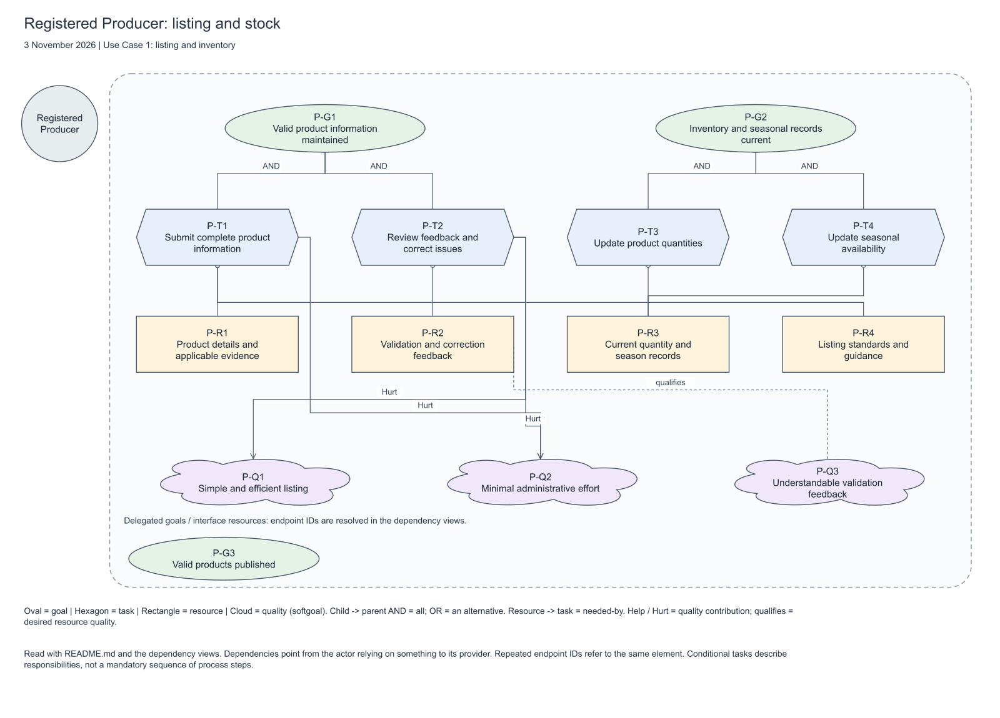

# Ayo's revised Strategic Rationale models

The SR content was updated on 3 November 2026 from repository main **9aeeddc** and Ayo's assigned [SR issue #17](https://github.com/emami11/bristol-regional-food-network/issues/17). On 9 November, the models were converted to the required **piStar** tool. Start with the [native five-actor piStar model](pistar/BRFN-Ayo-SR-Core.txt) for Use Case 1; see the [piStar loading instructions and native exports](pistar/README.md).

| File | Purpose |
|---|---|
| [Core SR in piStar](pistar/BRFN-Ayo-SR-Core.txt) | Five actors matching the actor analysis: Registered Producer, Customer, Marketplace Admin, Marketplace Platform and Certification Verification Service. |
| [Expanded SR in piStar](pistar/BRFN-Ayo-SR-Expanded.txt) | Eight actors: replaces Customer with the three buyer groups and includes the Payment Service as wider context, as requested in our earlier discussion. |
| [Core register](core/SR-REGISTER.md) | Exact goals, tasks, resources, qualities, internal links and dependency endpoints. |
| [Expanded register](expanded/SR-REGISTER.md) | The corresponding register for the broader view. |

Load the native `.txt` files through **File → Load Model** in piStar. The `core` and `expanded` folders retain the earlier `.drawio` sources and page exports as reference views; those files are opened in diagrams.net and cannot be loaded directly into piStar. Stable element IDs connect the references to the native model.

## Diagram pictures and source code

This is the producer page of the five-actor core model. The [core exports](core/exports/) contain a PNG picture and SVG for every actor and dependency page; the [expanded exports](expanded/exports/) include the buyer groups and payment context.

The native piStar `.txt` files are the required editable sources. The JSON model files in each variant record the source actors, intentions and relationships; these analysis JSON files are not directly importable in piStar. The `.drawio` files preserve the earlier drawing layout.

## What changed from the October draft

- Registered Producer now uses the actor name in the updated actor analysis.
- Core scope matches the five actors documented for Use Case 1; the requested payment and buyer segments are retained as a separate expanded view.
- The model includes the updated producer, customer, admin, platform and verification-service softgoals.
- Customer tasks explicitly include allergen and certification information.
- Admin tasks cover standards, producer guidance and compliance monitoring as well as unresolved verification review.
- Platform inventory tasks cover quantity/season changes, availability decisions and exclusion of unavailable products.
- Verification retry and authorised review are OR alternatives for handling an unavailable verification service. An unsuccessful retry does not satisfy the goal; the task label requires an obtained result.
- Settlement instructions use calculated allocation records, rather than requiring a later transfer result as their input.

## Read the notation

This revision uses [iStar 2.0](https://arxiv.org/html/1605.07767v3): circles for actors, ovals for goals, hexagons for tasks, rectangles for resources and clouds for qualities/softgoals. Generic actor symbols are used consistently. The actor document's Role/Agent/Position labels are recorded as background analysis, not mixed into a different notation version.

- **AND refinement:** all child responsibilities support the parent intention. Applicable certification checking includes the non-organic case where no external check is required.
- **OR refinement:** an alternative strategy may satisfy the parent goal. Operational BPMN must define retry limits, escalation timing and permitted decisions.
- **Needed-by:** a task needs a resource; this can include reading, updating or creating it. These are not data-flow arrows.
- **Help/Hurt:** a partial positive/negative effect on a quality, not a guarantee.
- **Qualifies:** identifies a desired quality of a resource. For example, validation feedback should be understandable.
- **Dependency:** depender -> typed dependum -> provider. Every dependency has its own ID and exact internal endpoints.

Each three-part dependency view is an SD projection of this SR model. It supports coordination with the SD owner, rather than claiming that the group's separately assigned SD work is complete.

## Scope and decisions to review

The core follows **Use Case 1** and the latest [actor analysis](../../../docs/actor-analysis.md), [requirements](../../../docs/requirements/README.md) and [proposed functionalities](../../../docs/requirements/PROPOSED-FUNCTIONALITIES.md). The expanded view adds payment/settlement context, not full detailed SR coverage of every enterprise business area.

Manual review is proposed in the functionality scope. The group's policy must define when publication is held, when corrected evidence is needed and who can authorise a decision. An outage does not verify an organic claim. Certification processing uses a simulated service, and financial interactions use test data.

Before presenting, agree the Customer-to-buyer-group mapping and i* notation with the SD owner. Contribution judgements and buyer task interpretations are modelling decisions; they are not stakeholder interview findings.

The new [traceability document](../../../docs/requirements/model-traceability.md) links stakeholder intentions to F1 and F2. Its local F2 mapping has been corrected to Inventory and Seasonal Availability. Xavier owns SD issue #16; no completed SD source is yet present on main, so the dependency views provide a proposal for joint checking rather than proof of completed SD review.

Your [personal strategic BPMN](../../../bpmn/personal/ayo/BRFN-Ayo-Strategic-BPMN.bpmn) covers the whole enterprise. It intentionally has wider scope than the five-actor core SR. Actor counts and BPMN pool counts need not be identical: customers are grouped in one pool and administrators work inside BRFN.

Edit the native model in piStar, then use **File → Save Model** and **File → Save Image** to refresh the editable source and pictures.
