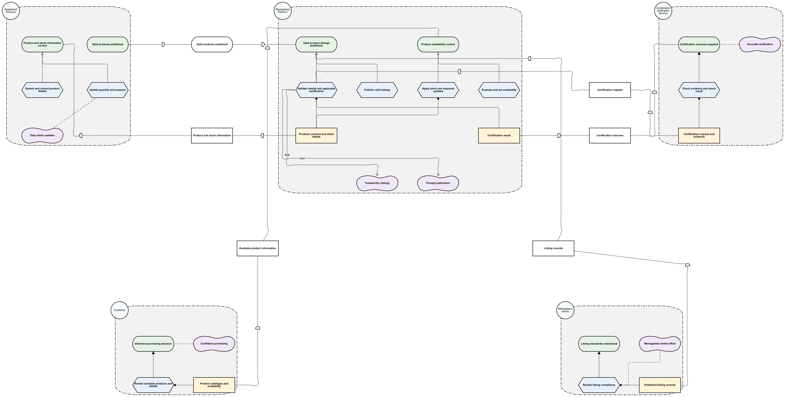

# Ayo's SR in piStar

**Start with [BRFN-Ayo-SR-Core.txt](BRFN-Ayo-SR-Core.txt).** This simplified five-actor model contains 27 internal elements and six dependencies for product listing and inventory management.

1. Download the `.txt` file using GitHub's **Download raw file** button.
2. Open [piStar](https://www.cin.ufpe.br/~jhcp/pistar/tool/).
3. Select **File → Load Model**, choose the file and click **Load model**.

Use **File → Save Model** to save edits and **File → Save Image** to export a picture. The `.txt` file contains native piStar JSON model data.

[Full-size PNG](BRFN-Ayo-SR-Core.png) · [SVG exported from piStar](BRFN-Ayo-SR-Core.svg)

## Supporting models

- [Detailed five-actor SR](BRFN-Ayo-SR-Detailed.txt): the previous 72-element, 14-dependency version, including verification exceptions. [Original piStar picture](BRFN-Ayo-SR-Detailed.png).
- [Expanded eight-actor SR](BRFN-Ayo-SR-Expanded.txt): buyer segments, payment and settlement context.
- [Producer-only learning view](BRFN-Ayo-SR-Producer-Focus.txt): an earlier focused view, without cross-actor dependencies.
- [Detailed modelling notes and reference registers](../DETAILED-NOTES.md).

## Checks

The simplified model was verified in the official piStar 2.1.0 web tool on **10 November 2026**. It loaded without a model warning, and the file downloaded through **File → Save Model** preserved all five actors, 27 internal elements, six dependencies and 33 links. Actor names, node labels and types, dependency endpoints and relationship labels were compared before and after saving.

Link routing was adjusted to avoid large loops in piStar's curved links; the intentions and relationships are unchanged. The committed `.txt` is the model saved by piStar. Its SVG was exported directly through **File → Save Image**, and the PNG was converted from that SVG without changing the diagram layout. The earlier offline relationship and endpoint checks also passed.

The archived detailed file was previously imported and saved in the official piStar tool, preserving all actors, elements, dependencies and links. The expanded and producer-focus files have structural checks.

The diagram groups validation checks and stock updates at an explanatory level. Detailed retries, review policy and payment context remain in the supporting models. Group review and consistency with the separate SD model are still required.
